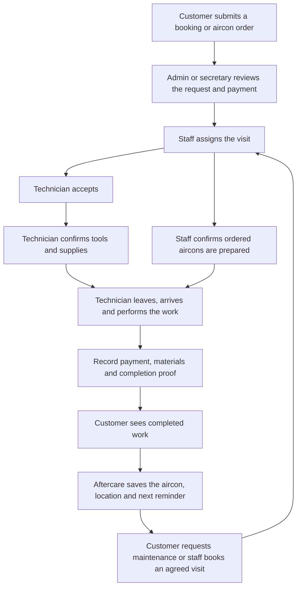

# Customer, staff, technician and aftercare flow

Audited on October 11, 2026. Changes are local and need deployment. Checks used source inspection, actual route handlers with model doubles, model validation and rendered page scripts. No live customer records, stock, payments or emails were changed.

The aircon preparation branch applies to deliveries. Delivery with installation needs both staff preparation and the technician's installation kit. Pickup uses staff readiness and pickup confirmation, without a technician delivery workflow.

| Step | Responsible person | Checks and connected records |
| --- | --- | --- |
| Submit service booking | Customer | Server checks the service price, address, available date and time; booking submission stores its related payment and accepted quotes. |
| Submit aircon order | Customer | Server checks stock, pricing, delivery or pickup details and payment; protected checkout writes keep the order and stock changes together. |
| Review and assign | Admin or secretary | Review the request and any required first-visit payment; assign eligible technicians within available capacity. Large projects retain their project schedule and team flow. |
| Prepare ordered aircons | Admin or secretary | Confirm Unit Prepared records the staff member and time. Assignment and technician acceptance do not prepare the physical aircon. |
| Accept and prepare | Assigned technician | Accept the job, review the Daily Kit and confirm stock checkout. New items added after confirmation must be prepared too. |
| Perform service | Assigned technician | Use assignment progress and proof endpoints; delivery orders use their order progress endpoints. Departure, ownership, materials and payment checks remain in these workflows. |
| Show progress | Customer | My Schedule includes reassignment, cancellation and repair states. My Schedule, booking history and aftercare refresh after events, reconnection or returning to the page, with an idle visible-page fallback every minute. Open forms defer refreshes. My Orders retains its update notice and Refresh orders button. |
| Complete and create aftercare | System | Completed installation orders create one asset per aircon with serial number and saved service location. Ordinary service completions create maintenance cycles; completed maintenance updates the existing aircon and creates its next cycle. |
| Repeat maintenance | Customer, admin or secretary | Aftercare visits use payment after service, without a new downpayment. Assisted booking needs customer agreement. Cancellation reopens the reminder when allowed; technicians collect the visit payment and submit completion proof. |

## Issues fixed

- My Schedule's query hid reassignment, cancellation and repair states. It now reads the customer's bounded booking feed without the incomplete status list, with readable status labels and matching counts.
- Socket updates changed a cached status without reading new dates, technicians or calendar data. Background refresh now reads current records and refreshes selected details while keeping the customer's selection and open forms safe.
- A late installation-kit item could appear ready after a staff decision even before checkout and confirmation. Related new items now block departure until confirmation; changed coverage with no extra stock also needs review.
- Technician order progress notified only the customer. It now uses the common event publisher for the customer, staff and assigned technician.
- An installation order's linked booking could generate another set of maintenance assets. The order now owns those assets and cycles; the linked booking does not create another set.
- Recovery treated any one aircon or cycle as proof that the whole completion had saved. It now checks all expected aircons and cycles before skipping a record, within the existing bounded recovery window.
- Old public status and appointment progress/payment shortcuts skipped assignment ownership, toolkit, payment or proof checks. They now return `ASSIGNMENT_WORKFLOW_REQUIRED`. The active admin/secretary screen no longer exposes its old Mark En Route button; technicians record departure in their assignment workflow.
- My Schedule counted a required downpayment as money received. It now uses recorded payments; the customer detail endpoint includes verified partial receipts. Linked installation schedules point to the original order's payment instead of presenting a separate balance.
- Maintenance cards, reminder checks, staff due-state updates and count queries used the server's local midnight. They now agree on the Manila calendar day.

## Verification and limits

276 checks passed across 33 test files covering booking submission and review, staff assignment, customer status and history, order preparation, toolkit confirmation, technician completion, payment failures, large projects, maintenance booking, saved locations, cancellation, renewal and rendered admin/secretary/customer scripts. Relevant older text and version assertions were updated to check current behavior.

New checks exercise the actual tracking feed, partial-payment calculation and retired shortcut handlers; per-unit order aftercare and repeat calls; recovery after partial saves; pickup installation-date requirements; Manila midnight; open-form and hidden-tab refresh handling; and a delayed detail response after switching jobs.

Production end-to-end checks still need deployment and authenticated customer, staff and technician sessions. Use a test booking and test order to verify receipt review, assignment, preparation notice, kit checkout, arrival, payment and proof, completion, then maintenance renewal and cancellation. Previously created duplicate assets are not deleted by this change. Recovery retains its existing recent-record window and batch limits; it is not a historical data cleanup.
